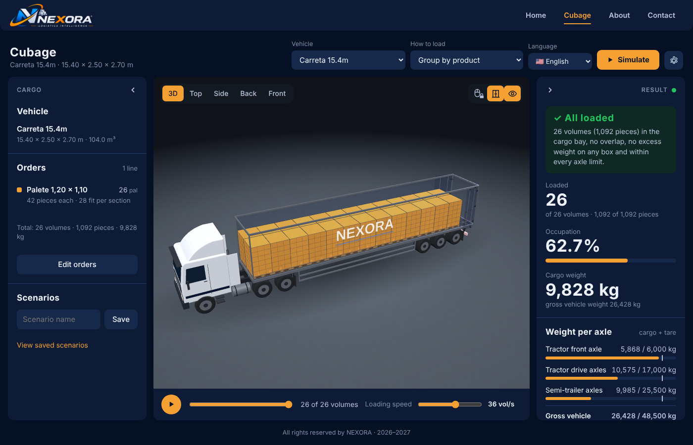
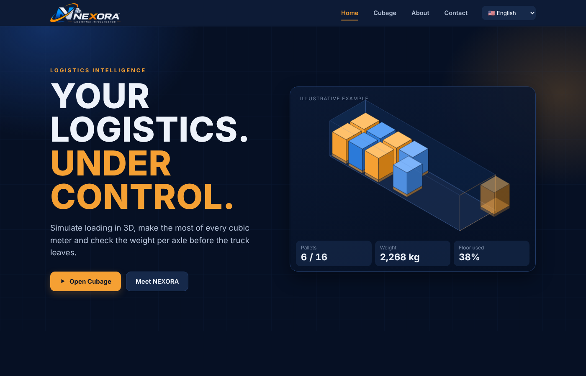
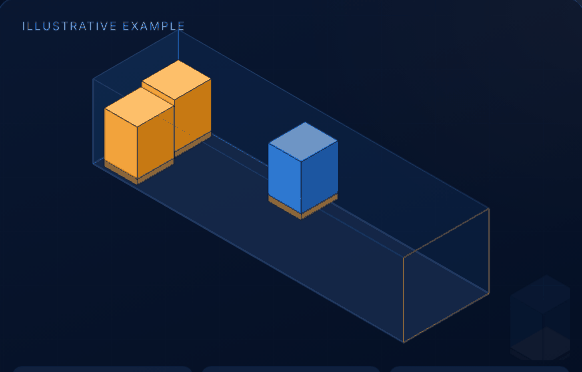

<div align="center">


### 3D truck loading simulator

*Your logistics. Under control.*

[](https://nodejs.org)
[](https://threejs.org)
[](LICENSE)
[](#)

**[Português](README.md)** · **[English](README.en.md)**

</div>

---

## About

**NEXORA Logistics Intelligence** is a simulator that shows, in 3D, how to load a truck before it leaves the yard. It calculates the used cargo volume, total weight and **weight on each axle**, and shows the unloading order per delivery stop.

Items are placed with the **Extreme Points** heuristic (Crainic, Perboli & Tadei, 2008), which avoids overlaps, respects each box's stacking capacity and each axle's limit.

<div align="center">



</div>

## Key features

- **Interactive 3D scene** — rotate, zoom, preset views (3D, top, side, back, front) and a loading animation with adjustable speed.
- **Load calculation** — volume, gross weight, weight per axle (tractor, trailer, road train) and comparison with legal limits.
- **Load editing** — drag or use the keyboard arrows to move an item, including **between sections** of a road train; the system blocks overlaps and excess weight on top.
- **Item orientation** — *Orientation* button (`O` key) with every valid position: pallet standing or lying down, lengthwise or widthwise; box in all 6 rotations. *Rotate 90°* (`R`) and *Lay down* (`D`) are also available.
- **Undo (Ctrl+Z)** — 10-step history for moving, rotating, laying down and changing orientation.
- **Floating 3D label** — the selected item shows a label above it with product, code, number, section, dimensions and weight (also included when printing).
- **Automatic extra vehicles** — if the cargo doesn't fit, the system picks the smallest fleet vehicle that carries the rest (up to 4) and shows each one alongside, already loaded. Click an extra to make it the active vehicle and edit its load, open its doors and undo.
- **Orders** — register products with dimensions, pieces per unit, weight and stacking capacity; quick filter by name or code in the list and in the edit table.
- **Unloading order** — list of items in the order they should come off, per wagon.
- **Saved scenarios** — keep named combinations and compare them side by side (e.g. 15.4 m semi-trailer vs. road train).
- **Export** — A4 print with an image of the loaded truck, summary and products, or a CSV spreadsheet (opens in Excel with correct accents).
- **Accessible** — color-blind modes (deuteranopia/protanopia, tritanopia and high contrast), product numbers in lists, keyboard navigation, screen-reader announcements and clear error messages.
- **Responsive** — layouts for phone (portrait and landscape), tablet, desktop and TV, including the website (hamburger menu on phones).
- **Animated website** — Home with counters and a vehicle ticker, About with a timeline and principles, Contact with an FAQ.
- **4 languages** — PT-BR, EN, ES and FR, with a selector in the header.
- **No install dependencies** — Three.js is bundled with the project; it only needs Node.js.

<div align="center">





</div>

## Getting started

Requirement: **Node.js 16 or newer**.

```bash
git clone <repository-url>
cd simulador-3d
npm start
```

Open **http://localhost:3000** in your browser.

To use another port: `PORT=3100 npm start`.

## Tests

```bash
npm test                # packing consistency: bay limits, no overlaps, default order
npm run test:seguranca  # server security checks (headers, routes, validation, rate limit)
```

## Project structure

```
server.js                    HTTP server and POST /api/simular route
public/
  home/                      home page, About and Contact
  cubagem/                   the simulator
    js/data.js               vehicles (real dimensions) and default order
    js/packer.js             Extreme Points algorithm (browser and Node)
    js/eixos.js              axles, tare, limits and weight per axle
    js/veiculos3d.js         3D vehicle models and doors
    js/app/nucleo.js         state, utilities, persistence and notices
    js/app/cena.js           Three.js scene and vehicles
    js/app/camera.js         camera, animation and resizing
    js/app/edicao.js         selection, dragging, keyboard and validation
    js/app/resultados.js     simulation and result panels
    js/app/modais.js         orders, settings and fleet
    js/app/exportar.js       A4 print and CSV
    js/app/descarga.js       unloading order
    js/app/cenarios.js       saved scenarios and comparison
    js/app/extras.js         undo, filter, 3D label, orientation and extra vehicles
    js/app/cores.js          color-blind color modes
  shared/                    palette, languages (i18n.js), navigation bar and vendor (local Three.js)
test/                        packing and security tests
docs/                        images used in this README
```

## How the calculation works

1. The order is turned into volumes with dimensions, weight and stacking capacity.
2. The Extreme Points algorithm tests placement points in the bay and picks the position that uses space best, with no overlap and respecting the maximum weight on each box.
3. Weights are distributed by item position and compared with each axle's limit.
4. The unloading order considers the wagon and each item's distance from the door.

## Security

- HTTP headers with a restrictive **Content-Security-Policy**, `X-Frame-Options: DENY` and `nosniff`.
- Static files served only from inside `public/`, with path-traversal protection.
- API input validated for size, type and range; per-IP request rate limit.
- Data stored in the browser (fleet and scenarios) is revalidated before use.

## Accessibility

- Visible focus and labels on view and tool controls.
- With a volume selected, arrow keys move it (Shift for a larger step).
- Error and status messages are announced to screen readers.
- **Settings → Accessibility**: *Deuteranopia / Protanopia* (Okabe-Ito palette), *Tritanopia* and *High contrast* color modes. Status messages no longer rely on green vs. red, and axle bars get stripes when within tolerance or over the limit.
- Option to show the product number in lists and on the 3D label, so color is not the only cue.
- The choice is saved in the browser; the website respects the system's *reduced motion* setting.

## Roadmap

- Native PDF export (without relying on the browser print dialog)
- Delivery-stop grouping in the unloading order
- Moving items between the main vehicle and the extra vehicles
- Automated UI tests (Playwright) in CI

## License

This project is **source-available**: anyone may use, study, improve and share modified versions, as long as the license and authorship notice are kept. **Commercial use requires prior written permission.** See [LICENSE](LICENSE).

---

<div align="center">

Developed by **Julio Cézar de Paula Baldo** · [LinkedIn](https://www.linkedin.com/in/julio-c%C3%A9zar-de-paula-baldo-51774321a/) · [GitHub](https://github.com/Julicars)

</div>
