# NEXORA Logistics Intelligence

Simulador de **montagem de carga em 3D** para transporte rodoviário. Calcula quantos volumes cabem em cada veículo, respeita empilhamento, peso por eixo e regras de manuseio, monta a carga **por destino** com roteirização, calcula o **piso mínimo de frete da ANTT** e tem um **fórum** para a equipe.

Feito só com **HTML, CSS, JavaScript e Node.js** — sem frameworks, sem banco de dados e sem login.

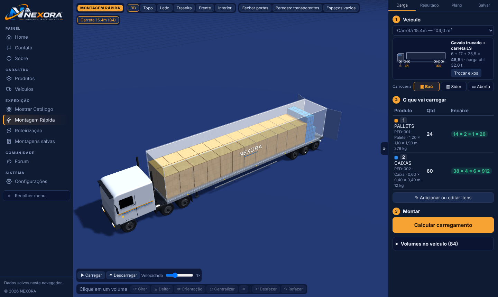

---

## Sumário

1. [Como rodar](#como-rodar)
2. [Telas](#telas)
3. [Funcionalidades](#funcionalidades)
4. [Roteirização e frete mínimo ANTT](#roteirização-e-frete-mínimo-antt)
5. [Fórum](#fórum)
6. [Atalhos de teclado](#atalhos-de-teclado)
7. [Acessibilidade e responsividade](#acessibilidade-e-responsividade)
8. [Estrutura de pastas](#estrutura-de-pastas)
9. [Configuração](#configuração)
10. [Testes](#testes)
11. [Regras e fontes](#regras-e-fontes)
12. [Limitações conhecidas](#limitações-conhecidas)

---

## Publicar na web (sem instalar nada)

Duas formas, as duas gratuitas:

**1. Site estático (sem servidor)** — GitHub Pages, Netlify ou Vercel, publicando a pasta `public/`.
- GitHub Pages: o arquivo `.github/workflows/pages.yml` já faz tudo. No repositório: *Settings → Pages → Source: GitHub Actions* e dê push na `main`.
- Netlify: arraste a pasta `public/` em app.netlify.com/drop (ou conecte o repositório; o `netlify.toml` já aponta para `public`).
- Vercel: importe o repositório (o `vercel.json` já aponta para `public`).

Funciona: montagem 3D, roteirização, frete ANTT, registros (salvos no navegador), instalar como app, uso sem internet e **consulta de empresas por CNPJ** (o navegador consulta direto BrasilAPI, minhareceita.org, OpenCNPJ, CNPJ.ws e CNPJá).
Pode falhar: busca por nome e rede de sócios completa, quando a fonte não libera acesso pelo navegador.

**2. Sistema completo (com o servidor Node)** — Render.com com o `render.yaml` (*New → Blueprint*).
Tudo funciona: fórum e registros compartilhados entre usuários, busca por nome, rede de sócios, cache de consultas.

> A prévia dentro do Claude bloqueia acesso a qualquer site externo: lá a consulta de empresas não funciona. Use uma das opções acima.

## Consulta de empresas (CNPJ)

Menu **Consultas → Consulta de empresas**. Digite o CNPJ ou parte do nome.

- **Consulta simples:** o básico do cadastro e alertas para quem vai contratar ou carregar.
- **Consulta completa:** sócios, CNAEs, Simples/MEI, inscrição estadual, sanções e o diagrama das empresas ligadas aos mesmos sócios.

Fontes públicas (base aberta de CNPJ da Receita Federal): minhareceita.org, BrasilAPI, OpenCNPJ, CNPJá (API pública, 5 consultas/min) e Casa dos Dados (busca por nome, até 20 resultados). Com `npm start` tudo passa pelo servidor, com cache em `data/empresas-cache.json`.

Opcional:
- `NEXORA_TRANSPARENCIA_CHAVE` — chave gratuita do Portal da Transparência para conferir sanções (CEIS/CNEP).
- `NEXORA_CASADOSDADOS_CHAVE` — chave da Casa dos Dados para busca por nome sem o limite da API pública.

O CPF dos sócios já vem mascarado pela Receita. A ligação entre empresas usa nome + CPF mascarado (homônimos com o mesmo trecho de CPF são raros, mas possíveis).

## Como rodar

**Requisito:** Node.js 18 ou mais novo (só para o servidor e os testes).

```bash
npm start                # abre em http://localhost:3000
```

Defina a senha do administrador do fórum (opcional, mas recomendado):

| Sistema | Comando |
|---|---|
| Linux / macOS | `NEXORA_ADMIN_SENHA=suaSenha npm start` |
| Windows (PowerShell) | `$env:NEXORA_ADMIN_SENHA="suaSenha"; npm start` |
| Windows (CMD) | `set NEXORA_ADMIN_SENHA=suaSenha && npm start` |

Sem a variável, uma senha aleatória é gerada e mostrada no terminal a cada início.

**Sem instalar nada:** abra `public/index.html` direto no navegador. Tudo funciona, menos o fórum compartilhado (ele entra em modo local) e o mapa com ruas (aparece o mapa próprio do Brasil).

| Variável | Para que serve | Padrão |
|---|---|---|
| `PORT` | Porta do servidor | `3000` |
| `NEXORA_ADMIN_SENHA` | Senha do administrador do fórum | gerada a cada início |
| `NEXORA_DADOS` | Pasta onde o fórum grava `forum.json` | `./data` |

---

## Telas

| | |
|---|---|
|  **Home** — visão geral, frota e atalhos | 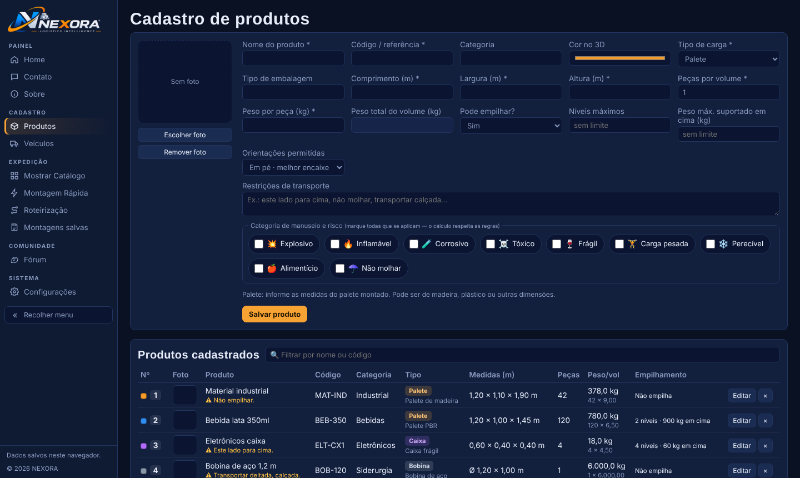 **Produtos** — cadastro com foto, medidas, peso e categorias de manuseio |
| 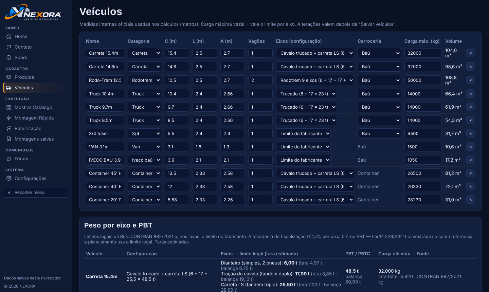 **Veículos** — frota, configuração de eixos e carroceria | 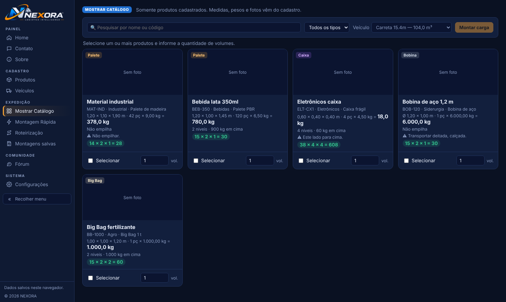 **Mostrar Catálogo** — monte o pedido com produtos cadastrados |
| 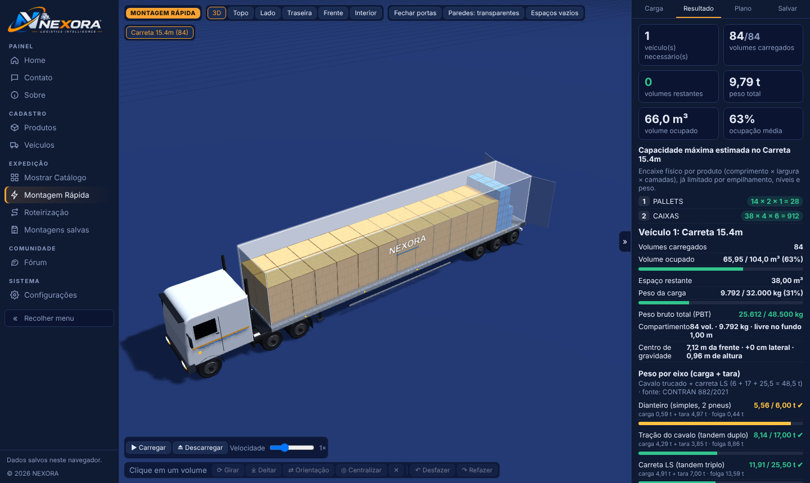 **Resultado** — ocupação, peso por eixo e centro de gravidade | 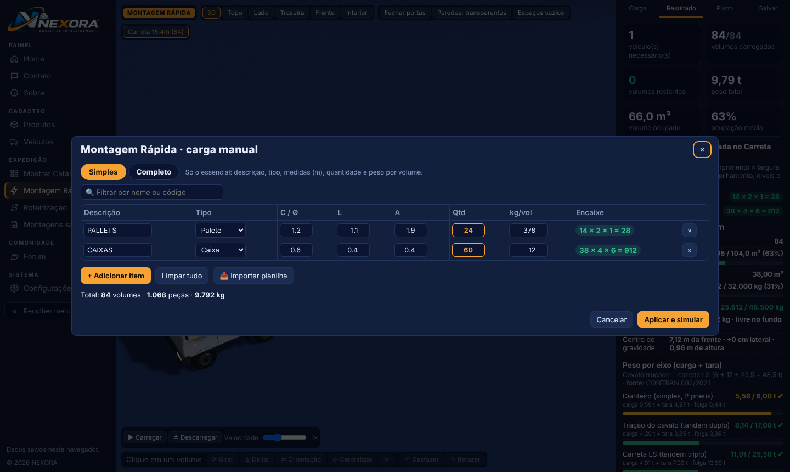 **Editor de carga** — modo Simples ou Completo |
| 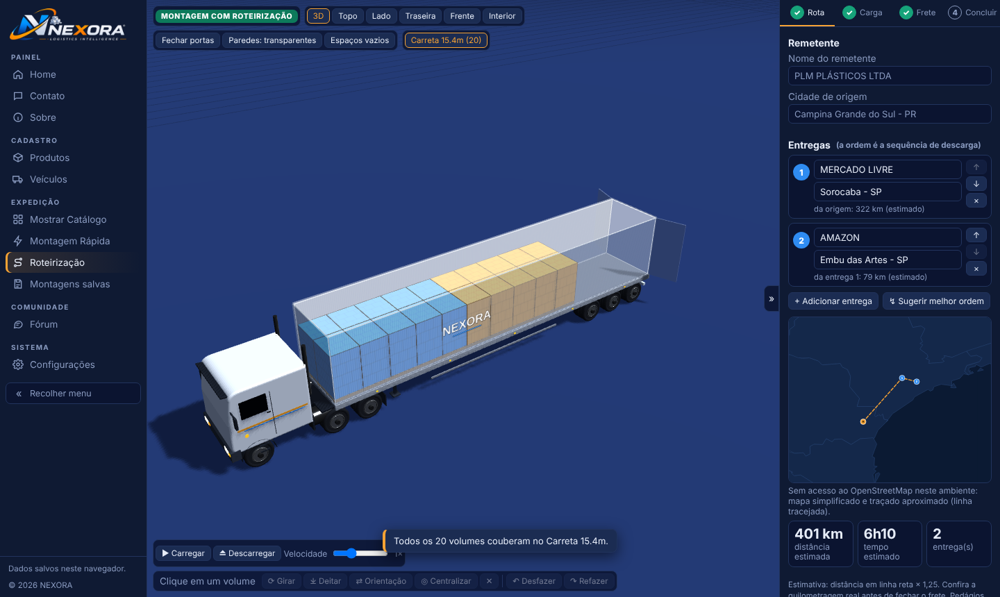 **Roteirização · 1 Rota** — remetente, entregas e mapa | 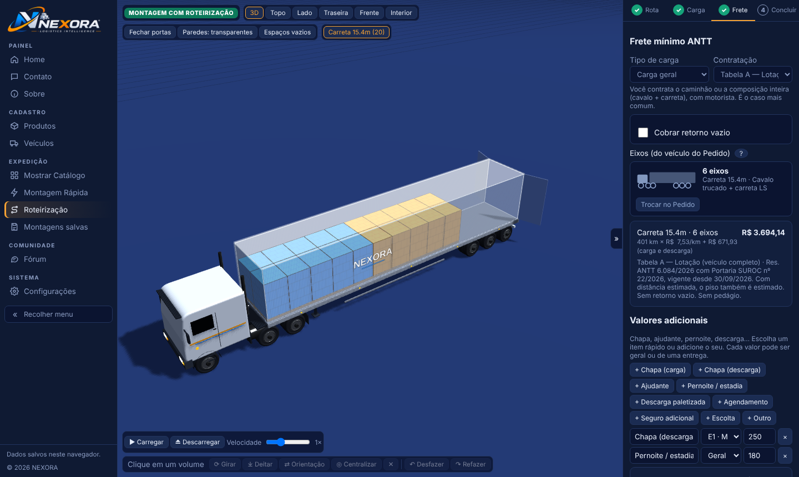 **Roteirização · 3 Frete** — piso ANTT, adicionais e total |
| 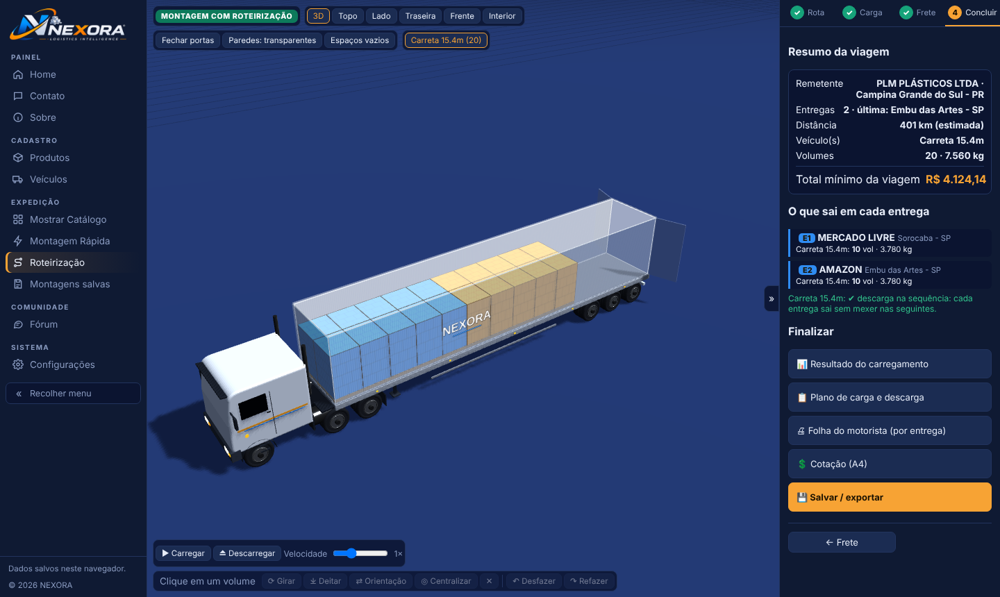 **Roteirização · 4 Concluir** — resumo e o que sai em cada entrega | 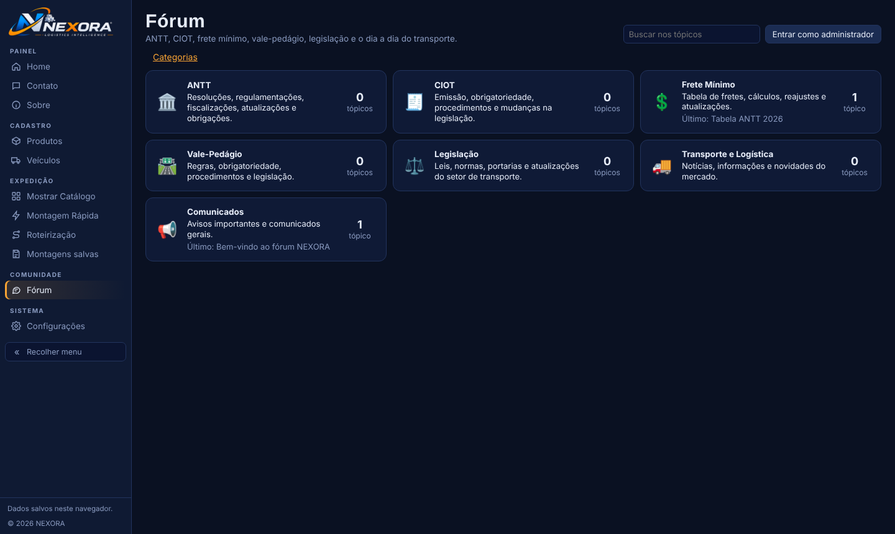 **Fórum** — ANTT, CIOT, frete mínimo, vale-pedágio… |
| 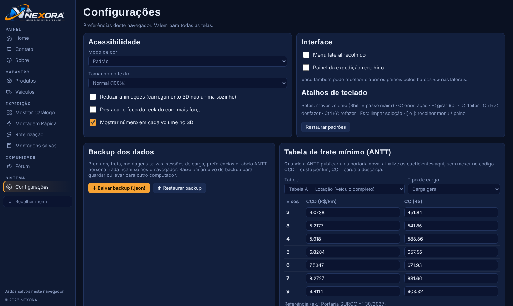 **Configurações** — acessibilidade, backup e tabela ANTT | 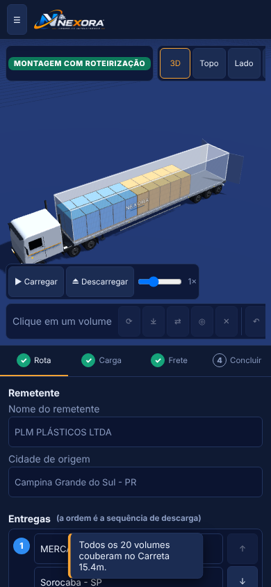 **No celular** |
| 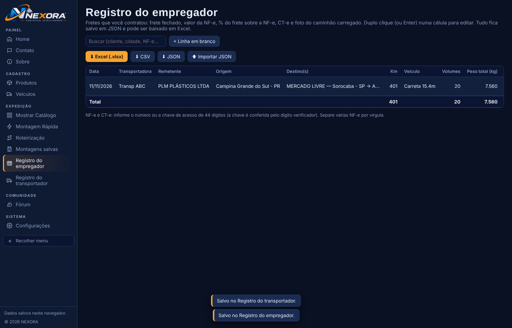 **Registro do empregador** — planilha web que vira Excel, com % do frete sobre a NF-e e foto do caminhão | 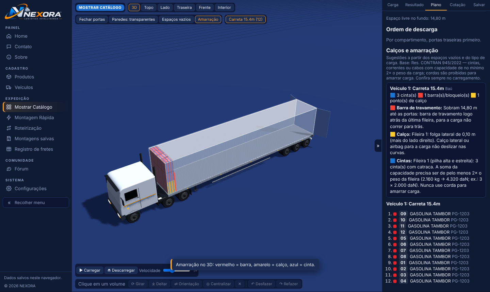 **Calços e amarração** — no 3D e no Plano |
| 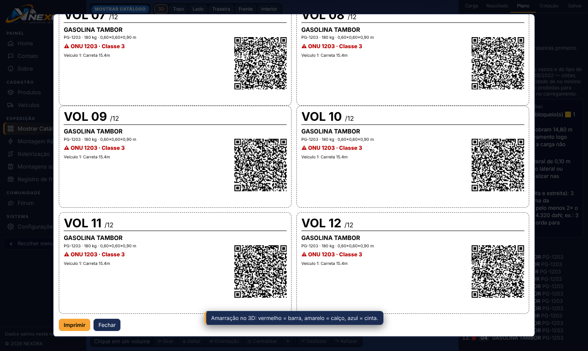 **Etiquetas com QR Code** — 8 por folha A4 | 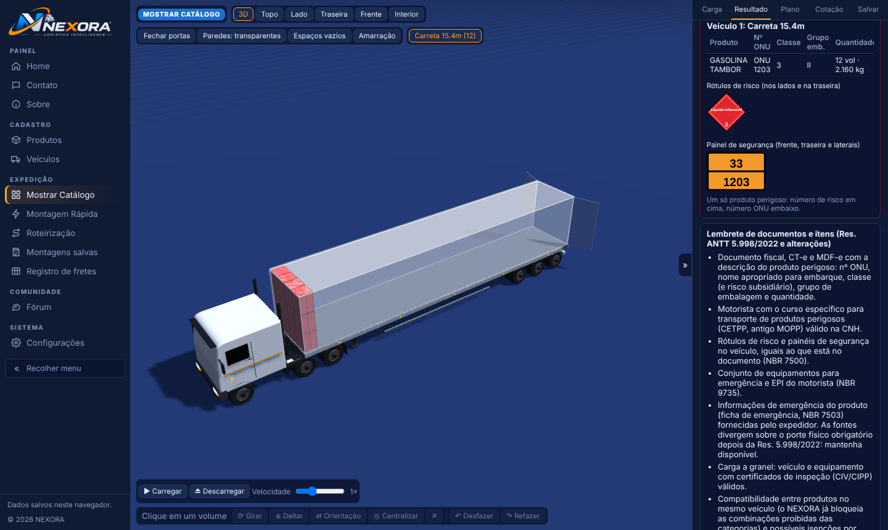 **Produtos perigosos** — rótulo, painel e lembrete |

---

## Funcionalidades

### Três formas de montar a carga
| Modo | Para quê | Guarda no cadastro? |
|---|---|---|
| **Mostrar Catálogo** | Pedido com produtos já cadastrados | Usa o cadastro |
| **Montagem Rápida** | Simulação rápida digitando medidas e pesos (sem cotação) | Não |
| **Roteirização** | Carga com várias entregas, em passo a passo (Rota → Carga → Frete → Concluir) | Não |

Cada modo tem a sua sessão: o que você faz em um não altera os outros.

### Motor de cálculo
- **Quem arruma a carga:** **🤖 Sistema** (respeita o peso por eixo e deixa volumes de fora se precisar) ou **✋ Usuário** (coloca tudo a partir da cabine sem mexer por eixo, só respeita o PBT; você arruma e acompanha o quadro **Peso por eixo** no 3D, que avisa mas não bloqueia).
- **Encaixe:** grade exata por produto (fileiras × colunas × camadas) e depois *Extreme Points* para aproveitar os espaços que sobram.
- **Empilhamento:** níveis máximos, peso que aguenta em cima e "não empilha".
- **Peso por eixo:** limites da Resolução CONTRAN 882/2021 para cada configuração. Se algum eixo passar do limite, o sistema primeiro reposiciona as fileiras ao longo do comprimento para distribuir o peso; só tira volumes da ponta sobrecarregada se ainda assim não couber. **Toda carga começa na cabine e vai sempre junta**, de qualquer produto: as fileiras ficam encostadas uma na outra, sem espaço, da cabine até o fundo. O sistema confere o peso como a balança: até 50 t vale o peso total (PBT); acima de 50 t, também cada eixo, com a tolerância legal de 12,5%; se ainda assim não couber, deixa volumes de fora e pergunta pelo veículo extra.
- **Categorias de manuseio:** frágil, carga pesada, perecível, alimentício, não molhar, explosivo, inflamável, corrosivo e tóxico, com regras de incompatibilidade (veja [Regras e fontes](#regras-e-fontes)).
- **Veículos extras:** quando a carga não cabe, o sistema **pergunta antes** de adicionar cada veículo, sugere o menor que leva o restante e explica o motivo. Containers nunca entram como extra.

### 3D
- Vistas 3D, topo, lado, traseira, frente e interior; portas, paredes transparentes e espaços vazios.
- Animação de carregamento e descarregamento, com velocidade ajustável.
- Selecionar, mover, girar, deitar e trocar a orientação de volumes, com desfazer e refazer. O motor confere cada movimento (colisão, apoio, empilhamento e eixos).
- Etiqueta do volume com medidas, peso, posição e, na Roteirização, **remetente e destino**.

### Importar itens de planilha
No editor de carga, **📥 Importar planilha** aceita um arquivo `.csv` ou linhas copiadas do Excel ou do Google Planilhas (com o cabeçalho). Colunas reconhecidas: Descrição, Código, Tipo, Comprimento, Largura, Altura, Quantidade, Peças, Peso por volume ou Peso por peça e Entrega (número, destinatário ou cidade). Aceita vírgula decimal. Há um botão para **baixar o modelo**. Arquivos `.xlsx` precisam ser salvos como CSV antes.

### Saídas
- Relatório A4 da montagem, cotação A4 (Catálogo e Roteirização) e planilha CSV.
- **Folha do motorista** (Roteirização › Concluir): uma página por entrega, com destinatário, trecho, volumes na ordem de retirada, posição no veículo, coluna ✓ e campo de assinatura.
- Montagens salvas no navegador, com comparação lado a lado.

### Transportador × Empregador (passo Frete da Roteirização)
No passo **3 Frete**, escolha **quem é você nesta viagem**:

| | 🚚 **Transportador** (você faz o transporte) | 🏢 **Empregador** (você contrata a transportadora) |
|---|---|---|
| Mostra | Piso ANTT, valores adicionais, **valor da NF-e**, frete cobrado, **pedágio** (informado), **ad valorem** e **GRIS** (% da NF-e), **ICMS** (sugestão interestadual 7%/12% pela Res. Senado 22/1989; dentro do estado você informa), **CBS 0,9% e IBS 0,1%** (alíquotas de teste de 2026, LC 214/2025), total da prestação do CT-e | **Frete mínimo** (piso ANTT), **frete fechado**, **valor da NF-e**, peso total, volumes, adicionais (incluso ou cobrado depois), **NF-e**, **CT-e**, etiquetas e **foto do caminhão carregado** |
| Calcula | Prestação = frete + pedágio + ad valorem + GRIS; ICMS incluso (por dentro); CBS e IBS sobre a prestação; frete/NF-e | **% do frete sobre a NF-e = total pago ÷ valor da NF-e × 100** |
| Salva em | **Registro do transportador** (`data/transportes.json`) | **Registro do empregador** (`data/fretes.json`) |

Origem, destinos, km, veículo, eixos, peso, volumes e piso entram automáticos. Os dois registros são **planilhas web**: duplo clique, Enter ou toque na célula para editar; × para excluir; busca; totais; média de frete/NF-e; aviso de **frete abaixo do piso ANTT**; exportação **Excel (.xlsx)**, CSV e JSON; importação de JSON. NF-e e CT-e aceitam número ou chave de 44 dígitos (dígito verificador e modelo 55/57 conferidos). Os registros não têm login: use o servidor só em rede interna. Tributos são estimativas de apoio; confira com a contabilidade.

### Calços e amarração
Botão **Amarração** no 3D e seção no **Plano**: barra de travamento (vermelho), calço (amarelo) e cintas (azul), calculados a partir das folgas na frente, entre fileiras, nas laterais e até as portas, do tipo de carroceria e das pilhas altas. As cintas seguem a Res. CONTRAN 945/2022: capacidade somada de pelo menos **2× o peso** da fileira, e corda nunca. Bobinas lembram berço, calços e amarração de topo (Res. CONTRAN 701/2017). É uma sugestão de apoio: a amarração final é de quem carrega.

### Etiquetas com QR Code
Em **Salvar** (todos os modos) ou **Concluir** (Roteirização): uma etiqueta por volume, 8 por folha A4, com o número do volume, o produto, o peso, as medidas, a entrega (E1, E2…), o destinatário e, se for perigoso, o nº ONU e a classe. O QR tem **texto simples**, sem link: qualquer leitor de QR do celular mostra os dados para o motorista conferir.

### Produtos perigosos
No cadastro de produto, a seção **Dados de produto perigoso** tem nº ONU, classe ou subclasse, risco subsidiário, grupo de embalagem, número de risco e nome apropriado para embarque. Ela abre sozinha ao marcar explosivo, inflamável, corrosivo ou tóxico. No **Resultado** aparecem, por veículo:
- os **rótulos de risco**;
- o **painel de segurança**: número de risco e ONU, ou painel liso se houver mais de um produto;
- um **lembrete de documentos** (Res. ANTT 5.998/2022 e alterações): descrição no documento fiscal, CT-e e MDF-e, curso do motorista (CETPP), sinalização (NBR 7500), kit de emergência (NBR 9735), informações de emergência (NBR 7503) e CIV/CIPP para granel.

O lembrete não substitui a regulamentação: a classificação e os documentos são responsabilidade do expedidor e do transportador.

### Backup
Em **Configurações › Backup dos dados**, baixe um arquivo `.json` com produtos, frota, montagens, sessões, preferências e tabela ANTT personalizada, e restaure em outro navegador ou computador.

---

## Roteirização e frete mínimo ANTT

**Passo a passo:**

1. **Rota:** remetente, cidade de origem e entregas (destinatário e cidade). A busca de cidades usa a base do IBGE (5.570 municípios), que já vem no sistema e funciona sem internet. O botão *Sugerir melhor ordem* calcula a sequência de menor distância (vizinho mais próximo + 2-opt), e você ajusta com ↑ ↓.
2. **Carga:** veículo e itens, cada um com a sua entrega. O carregamento é feito **pelo inverso da entrega**: a última entrega vai perto da cabine e a primeira fica junto às portas.
3. **Frete:** piso ANTT, valores adicionais (chapa, ajudante, pernoite, descarga paletizada, agendamento, seguro, escolta ou outro) e o **total mínimo da viagem**. O botão *Levar para a Cotação* preenche a cotação.
4. **Concluir:** resumo, o que sai em cada entrega, aviso se algum volume ficou bloqueado por carga de entrega posterior, e acesso ao resultado, plano, cotação e salvar.

**Mapa e quilometragem:** com internet, usa OpenStreetMap (Leaflet) e a rota real do OSRM. Sem internet, mostra um mapa próprio do Brasil e a distância **estimada** (linha reta × 1,25), sempre identificada como estimativa. **Pedágios não são calculados.**

**Piso mínimo:** `Piso = km × CCD + CC`, pela Resolução ANTT 6.084/2026 com a **Portaria SUROC nº 22/2026** (vigente desde 30/09/2026), com os 12 tipos de carga e de 2 a 9 eixos. Escolha a contratação:

| Tabela | Quando usar |
|---|---|
| **A** — Lotação | Você contrata o caminhão ou a composição inteira (cavalo + carreta), com motorista. O caso mais comum. |
| **B** — Lotação, só o cavalo | Você contrata apenas a unidade de tração; a carreta é sua ou de terceiros. Só de 4 eixos para cima. |
| **C** — Alto desempenho | Operação de alto desempenho (definição da ANTT), com o veículo completo. |
| **D** — Alto desempenho, só o cavalo | Alto desempenho contratando apenas a unidade de tração. |

**Retorno vazio:** opcional no passo Frete. Vale 92% do CCD × a distância de volta (Res. ANTT 5.867/2020) e é obrigatório no transporte de contêiner e em frota dedicada ou fidelizada. A distância de volta vem estimada e pode ser ajustada.
- O número de eixos vem **automático do veículo** escolhido na Carga (configuração de eixos da frota).
- **Vans e furgões até 3,5 t** (veículo de carga de pequeno porte, Lei 15.485/2026) não entram na tabela por eixos: o sistema avisa e não calcula piso.
- Quando a ANTT publicar uma nova tabela, atualize em **Configurações › Tabela de frete mínimo** (fica salvo no navegador e entra no backup) ou troque os números oficiais em `public/src/config/antt.js`.
- Confira sempre na [calculadora oficial da ANTT](https://calculadorafrete.antt.gov.br/) antes de fechar um frete.

---

## Fórum

Categorias: **ANTT, CIOT, Frete Mínimo, Vale-Pedágio, Legislação, Transporte e Logística e Comunicados**.

- **Quem publica:** só o administrador cria, edita, fixa, fecha e apaga tópicos (e edita ou apaga respostas). Qualquer pessoa responde informando um nome ou apelido, sem cadastro, e pode **editar as próprias respostas** feitas no mesmo navegador (chave secreta guardada no navegador; o servidor só guarda o resumo criptográfico).
- **Norma em destaque:** cada tópico pode ter uma norma de referência (nome e link), mostrada em destaque no topo.
- **Novidades:** o menu mostra quantas novidades há desde a sua última visita; as categorias, os tópicos e as respostas novas ganham o selo "nova", e o administrador vê um aviso para moderar.
- **Onde fica:** em `data/forum.json` (sem banco de dados). Faça backup desse arquivo.
- **Proteções:** limite de mensagens por minuto, limite de tentativas de senha, sessão do administrador de 8 horas e textos sem HTML (links viram links seguros).
- **Sem servidor:** modo local, salvo só no navegador, com aviso na tela.

| Rota da API | Método | Quem |
|---|---|---|
| `/api/forum` | GET | todos |
| `/api/forum/login` · `/logout` | POST | administrador |
| `/api/forum/topics` | POST | administrador |
| `/api/forum/topics/:id` | PUT · DELETE | administrador |
| `/api/forum/topics/:id/replies` | POST | todos |
| `/api/forum/topics/:id/replies/:rid` | PUT | administrador ou autor (com a chave) |
| `/api/forum/topics/:id/replies/:rid` | DELETE | administrador |
| `/api/fretes` · `/api/transportes` | GET · POST | todos (registros do empregador e do transportador) |
| `/api/fretes/:id` · `/api/transportes/:id` | PUT · DELETE | todos |

---

## Atalhos de teclado

Clique no 3D (ou selecione um volume na lista) para o teclado ir para a cena.

| Tecla | Ação |
|---|---|
| Setas | Move o volume (Shift = passo maior) |
| R | Gira 90° |
| D | Deita |
| O | Próxima orientação |
| Ctrl + Z / Ctrl + Y | Desfaz / refaz |
| Esc | Tira a seleção |
| [ e ] | Recolhe o menu / o painel |

As teclas funcionam mesmo durante a animação (ela é encerrada).

---

## Acessibilidade e responsividade

- Auditoria automática **axe-core (WCAG 2 A/AA)** em todas as telas: nenhuma falha crítica, grave ou moderada.
- Lista de volumes navegável por teclado, com descrição falada da posição de cada volume; o 3D tem texto de ajuda para leitores de tela.
- Janelas com foco preso, Esc fecha e o foco volta para quem abriu.
- Erros de formulário ligados ao campo, com foco no primeiro campo com problema.
- Alvos de toque de 44 px em telas de toque, textos com no mínimo 12 px e contraste revisado.
- Configurações: tamanho do texto, menos movimento, foco reforçado e modos de cor para daltonismo e alto contraste.
- Verificado em 9 tamanhos de tela, sem nada cortado ou saindo para os lados: iPhone SE, iPhone 14, Galaxy Fold, Pixel, iPad Mini (em pé e deitado), notebook, desktop Full HD e celular deitado. No celular, o editor de carga vira cartões.

---

## Estrutura de pastas

```
nexora/
├─ README.md                 este arquivo
├─ CHANGELOG.md              histórico de versões
├─ package.json              npm start · npm test
├─ server/
│  ├─ index.js               servidor HTTP (arquivos estáticos + APIs)
│  ├─ forum.js               fórum: regras, senha, limites, gravação em JSON
│  └─ fretes.js              registros do empregador e do transportador (JSON)
├─ test/
│  ├─ engine.test.js         testes do motor de cálculo
│  ├─ forum.test.js          testes da API do fórum
│  └─ fretes.test.js         testes do registro de fretes
├─ docs/img/                 capturas de tela usadas neste README
├─ data/                     criada ao rodar: forum.json, fretes.json e transportes.json (fora do controle de versão)
└─ public/
   ├─ index.html             casca: menu lateral e área das páginas
   └─ src/
      ├─ config/             o que você ajusta sem mexer no código
      │  ├─ veiculos.js        frota, carga máxima, altura legal, assoalho
      │  ├─ categorias.js      categorias de manuseio/risco e carrocerias
      │  └─ antt.js            tabela de piso mínimo (Tabela A)
      ├─ data/
      │  ├─ municipios.js      5.570 municípios do IBGE (nome, UF, coordenadas)
      │  └─ brasil.js          contorno dos estados (mapa offline)
      ├─ css/
      │  ├─ base.css           cores, tipografia, componentes
      │  ├─ layout.css         expedição, janelas, painéis
      │  ├─ pages.css          Home
      │  └─ responsive.css     telas, acessibilidade, roteirização e fórum
      ├─ js/
      │  ├─ core/              engine.js (motor) · storage.js (navegador) · xlsx.js (Excel)
      │  ├─ 3d/                scene.js (Three.js)
      │  ├─ app/               app.js (telas) · rota.js (roteirização) · forum.js · a11y.js
      │  │                     ferramentas.js (backup e tabela ANTT) · importar.js (planilha)
      │  │                     fretes.js (registro) · amarracao.js · etiquetas.js · perigosos.js
      │  └─ pages/             uma página por arquivo (HTML montado em JS)
      ├─ img/                  logo e ícone
      └─ vendor/               leaflet/ (mapa, BSD-2) · qrcode/ (QR Code, MIT)
```

---

## Configuração

| Arquivo | O que muda |
|---|---|
| `public/src/config/veiculos.js` | Frota padrão, carga máxima por veículo, altura legal (4,40 m), altura do assoalho |
| `public/src/config/categorias.js` | Categorias de manuseio, incompatibilidades e carrocerias |
| `public/src/config/antt.js` | Coeficientes oficiais CCD e CC das Tabelas A, B, C e D (os personalizados ficam em Configurações) |

O motor lê esses arquivos tanto no navegador quanto nos testes.

---

## Testes

```bash
npm test
```

São 31 testes: o motor (encaixe, empilhamento, eixos, categorias, extras e verificação de montagem salva) a API do fórum (permissões, senha, respostas, edição com chave, norma e gravação) e os registros de fretes (criar, alterar, apagar, limpeza dos dados, separação empregador × transportador e gravação).

---

## Regras e fontes

**Configurações de eixos (CONTRAN 882/2021)**

| Configuração | Limites por eixo | PBT/PBTC |
|---|---|---|
| Toco | 6 + 10 t | 16 t |
| Trucado | 6 + 17 t | 23 t |
| Cavalo toco + carreta LS | 6 + 10 + 25,5 t | 41,5 t |
| Cavalo trucado + carreta LS | 6 + 17 + 25,5 t | 48,5 t |
| Cavalo toco + vanderléia | 6 + 10 + 10 + 10 + 10 t | 46 t |
| Romeu e Julieta trucado | 6 + 17 + 10 + 10 t | 43 t |
| Rodotrem 9 eixos | 6 + 17 + 17 + 17 + 17 t | 74 t |

**Carroceria aberta:** a altura útil é 4,40 m (altura máxima legal) menos a altura do assoalho.

**Categorias de manuseio**

| Categoria | Regra no cálculo |
|---|---|
| Frágil | Nada vai em cima |
| Carga pesada | Só no piso |
| Perecível, Alimentício, Não molhar | Não vão em carroceria aberta |
| Explosivo | Não viaja com inflamável, corrosivo, tóxico, alimentício ou perecível |
| Tóxico, Corrosivo | Não viajam com alimentício ou perecível |
| Inflamável | Não viaja com explosivo |

Essas regras são uma simplificação. Para produtos perigosos, confira sempre a regulamentação da ANTT, a ficha de emergência e a compatibilidade do produto.

**Dados de terceiros:** municípios do IBGE via [kelvins/municipios-brasileiros](https://github.com/kelvins/municipios-brasileiros) (MIT) · contorno dos estados via [click_that_hood](https://github.com/codeforgermany/click_that_hood) · mapa [Leaflet](https://leafletjs.com) (BSD-2) e © colaboradores do OpenStreetMap · rotas [OSRM](https://project-osrm.org) · 3D [Three.js](https://threejs.org) r128 (MIT) · QR Code [qrcode-generator](https://github.com/kazuhikoarase/qrcode-generator) (MIT).

---

## Limitações conhecidas

- Produtos, frota e montagens ficam **no navegador** de quem usa: limpar os dados do navegador apaga tudo. Exporte em CSV ou PDF o que for importante.
- Sem internet, a distância é estimada e o piso também; os pedágios não são calculados.
- O retorno vazio usa a distância de volta estimada se você não informar a do contrato.
- A importação não lê `.xlsx` diretamente (use CSV ou copie e cole).
- O fórum e os registros compartilhados precisam do servidor (`npm start`). O registro não tem login: use o servidor só em rede interna.
- Calços, amarração e o lembrete de produtos perigosos são sugestões de apoio, não laudo técnico.
